# SRMIST website audit: As-Is and To-Be

To-Be screenshots show an **independent redesign concept**. It is not the official SRMIST website, and nothing here implies it has replaced the official site or application portal.

## 1. Scope, date, tools and viewports

| Item | Detail |
| --- | --- |
| Capture date | 5 November 2026 |
| Browser | Google Chrome, headless, driven by Playwright 1.64.1 |
| Accessibility tool | axe-core 4.14.0, rules `wcag2a`, `wcag2aa`, `wcag21aa` |
| Performance tools | None run. No performance scores are claimed. |
| As-Is viewports | Desktop 1440x900, mobile 390x844 |
| To-Be viewports | Desktop 1440x900, tablet 768x1024, mobile 390x844 |

## 2. Pages and journeys inspected

| Journey | Page | URL |
| --- | --- | --- |
| Entry | Homepage | https://www.srmist.edu.in/ |
| Apply | Admissions hub | https://www.srmist.edu.in/admissions/ |
| Apply | Admission India | https://www.srmist.edu.in/admission-india/ |
| Apply | Admission International | https://www.srmist.edu.in/admission-international/ |
| Apply | Engineering scholarships | https://www.srmist.edu.in/admission-india/engineering/scholarships/ |
| Apply | Application portal | https://applications.srmist.edu.in/ |
| Choose | Program Finder | https://www.srmist.edu.in/program-finder/ |
| Choose | B.Arch detail | https://www.srmist.edu.in/program/b-arch-bachelor-of-architecture/ |
| Research | Research | https://www.srmist.edu.in/research/ |
| Research | Collaborations | https://www.srmist.edu.in/research/collaborations/ |
| Trust | Accreditations and rankings | https://www.srmist.edu.in/about-us/accreditations-and-rankings/ |

## 3. Starting audit: what was verified

| Starting finding | Result | Evidence |
| --- | --- | --- |
| Campaign overlay covers the homepage | **Confirmed, and worse on mobile** | See H1 and H2 |
| Counters show `0` or `0+` | **Not a visible bug** | All 14 stayed `0` for 6 seconds without scrolling, then showed real values (1985, 250+, 50,000+) once scrolled into view. `0` is the animation start state. |
| Academics and Research are `#` links | **Confirmed, cause identified** | They are Elementor Tabs, not a navigation menu. See H3. |
| Admissions has 2022 notices, 2024 update date | **Confirmed in markup** | "Page Updated: Dec 11th, 2024". The "Latest Updates" block and its SRMJEEE 2022 links sit in a hidden popup (0 height until opened). The popup was not opened and viewed. |
| Portal lists 2026 admissions | **No longer current** | The portal now shows "ADMISSIONS OPEN: 2027". See A1. |
| Program Finder has 72 pages | **Confirmed** | 72 pages; 429 entries collected across all level filters. |
| Campus, college, department selects have no label | **Confirmed** | axe `select-name`, 3 nodes, critical. |
| No overflow on Program Finder at 390px and 1366px | **Consistent at 390px** | 0px at 390. At 1440 see T1. 1366px was not retested. |
| 403 from an extraction tool | **Not a defect** | Excluded as instructed. Browser access returned 200. |

## 4. Evidence-based findings

Severity reflects impact on the task. Status is **Confirmed** or **Needs testing**.

### Homepage: https://www.srmist.edu.in/

| ID | User task | Issue and evidence | Severity and impact | Proposed fix | Status |
| --- | --- | --- | --- | --- | --- |
| H1 | Reach any content | Overlay appears 3 to 6 seconds after load, after the visitor has started reading. It returned on reload and on a later visit in the same session. It did not appear on Research. | High. Interrupts every homepage visit. | In-flow notice, dismissed once. | Confirmed |
| H2 | Dismiss the overlay | The close control is a 15x15px `div` with no role, label or tabindex. At 390px its computed style is `display:none`, with the campaign image still on screen. The modal has no `role="dialog"` or `aria-modal`, focus stays on `body`, and all content is an image with empty alt text. Esc does close it on desktop. | High. Touch users get no visible way to close it, and screen readers get no content. | Real text, a labelled 44px button. | Confirmed. Whether tapping outside closes it was not tested. |
| H3 | Navigate by keyboard | Academics, Research, Campus Life, International and About are `href="#"` links inside `role="tab"` elements (axe `nested-interactive`). Enter opens the panel, but Tab then moves to the next title, not into the panel, and Esc leaves it open. | High. Keyboard users cannot move directly from a title to its links. No landing page exists from the title. | Real link plus a separate menu button. | Confirmed on desktop. Mobile menu by keyboard not tested. |
| H4 | Understand the page | No `h1`, with 56 `h2` elements. | Medium. Weak structure for assistive technology. | One `h1`, ordered headings. | Confirmed |
| H5 | Use named controls | axe: `link-name` 36, `button-name` 2, `color-contrast` 17, `nested-interactive` 5, `aria-required-children` 1, `aria-allowed-attr` 1. | High. Unnamed links are announced with no purpose. | Named controls, checked contrast. | Confirmed |
| H6 | Scan the page | Page height is 14,079px on desktop and 34,159px on mobile. Carousel slides repeat in the DOM. | Medium. Long scroll to reach key tasks. | Three journeys directly below the hero. | Confirmed |
| H7 | Compare facts | Homepage says "300+ Programs"; the Program Finder holds 429 entries. | Low. The two may count differently. | Define and date the figure. | Needs testing |

### Admissions: https://www.srmist.edu.in/admissions/

| ID | User task | Issue and evidence | Severity and impact | Proposed fix | Status |
| --- | --- | --- | --- | --- | --- |
| A1 | Identify the current cycle | Labels differ: header "Admissions 2027", homepage "Admissions 2026-2027", portal "ADMISSIONS OPEN: 2027", and an international "Admission 2027" page linking to `international-application-2026`. | High. Applicants cannot tell which cycle applies. | One label, sourced. | Confirmed |
| A2 | Find requirements | The hub is mostly campus promotion. Routes, fees and eligibility sit on `/admission-india/`, one level down. | High. The main task is not on the hub. | Steps and routes on the page. | Confirmed |
| A3 | Trust the facts | Dated claims appear undated or old: ARIIA 2020, and page update Dec 2024. The portal says "Ranked 35th" by NIRF, while the rankings page shows 11 for 2025. | Medium. Conflicting recognition data. | Dated, sourced facts only. | Confirmed |
| A4 | Find scholarships | Scholarship details are under an Engineering path, with no route from the hub text. | Medium. Applicants in other faculties may miss them. | Funding section on the hub. | Confirmed for the page checked |
| A5 | Use on mobile | Layout viewport widens to 405px at 390px because of a carousel. Horizontal scroll did not move. | Low. Slight scaling. | Contained layouts. | Needs testing on a real device |

### Program Finder: https://www.srmist.edu.in/program-finder/

| ID | User task | Issue and evidence | Severity and impact | Proposed fix | Status |
| --- | --- | --- | --- | --- | --- |
| P1 | Filter programmes | Campus, college and department selects have no accessible name (axe `select-name`, 3, critical). | High. Filters are unusable with a screen reader. | Visible labels. | Confirmed |
| P2 | Judge the results | No visible result count; 6 results per page across 72 pages. | High. Slow to browse 429 entries. | Live count and progressive loading. | Confirmed |
| P3 | Read consistent labels | "Programs", "Program Finder" and "Programme" all appear. The campus list includes a stray "(formerly Science and Humanities)" option, and raw markup leaks into department options (`data-counter-prefix`). Seven `h1` elements appear on the page. | Medium. Looks unfinished. | One term, clean options, one `h1`. | Confirmed |
| P4 | Compare durations | Source values vary: `1`, `1 Year`, `1 Years`, `3-5`, and an encoding fault in `3 � 5 years`. | Low. Hard to filter. | Normalised duration values. | Confirmed |

### Research: https://www.srmist.edu.in/research/

| ID | User task | Issue and evidence | Severity and impact | Proposed fix | Status |
| --- | --- | --- | --- | --- | --- |
| R1 | Find my route | Overview, mission, policies, funding, collaborations and centres run on one 10,395px page, not grouped by audience. | High. Each audience must search the whole page. | Task-based pathways. | Confirmed |
| R2 | Trust the figures | 294+ crores, 660+ projects, 44,500+ and 58,000+ publications, 1,100+ patents appear with no reference date or definition. | Medium. Cannot be cited. | Show source and limits. | Confirmed |
| R3 | Read the copy | "greate potential", "it It brings", "aMRC", "Volvo' First", "have taken" with a singular subject. | Low. Undermines credibility. | Copy edit. | Confirmed |

### Technical

| ID | Issue and evidence | Severity | Status |
| --- | --- | --- | --- |
| T1 | `scrollWidth` exceeds the viewport by 36px at 1440, but `html` has `overflow-x:hidden`, so visitors cannot scroll to it. | None for visitors. Not a defect. | Confirmed |
| T2 | Portal desktop: decorative `.cloud` element extends about 187px past the viewport. | Low | Needs testing |
| T3 | Portal mobile: page error `TrustLogo is not defined`. Portal has no `h1` or `main`, and 8 images have no `alt`. | Medium | Confirmed |
| T4 | No broken images or browser console errors on the 5 main-domain pages at either viewport. | Positive | Confirmed for those loads |

## 5. Comparison summary

| Page | As-Is problem | User impact | To-Be fix |
| --- | --- | --- | --- |
| Homepage | Repeating overlay, no `h1`, tab-based menu | Blocked or slowed first task | Three direct journeys, dismissible in-flow notice, real menu controls |
| Admissions | Promotion first, mixed year labels, hidden stale notices | Hard to find the correct route | Steps, 16 official routes, funding, international waivers, one label |
| Academics | 72 pages, no count, unlabelled filters | Slow, inaccessible browsing | Search, labelled filters, live count, 429 entries, progressive loading |
| Research | One long page, undated figures | Audiences must hunt | Three pathways, sourced figures with stated limits, centres directory |

## 6. As-Is and To-Be screenshots

As-Is images are genuine captures of the live pages on 5 November 2026. To-Be images are the implemented concept at the same viewport.

### Homepage

Issue: the overlay hides the main tasks. Impact: visitors must dismiss a campaign first, and mobile shows no close control. Fix: the page leads with the identity and three journeys, and the campaign is a small dismissible strip.

| Viewport | As-Is | To-Be (concept) |
| --- | --- | --- |
| Desktop 1440x900 | 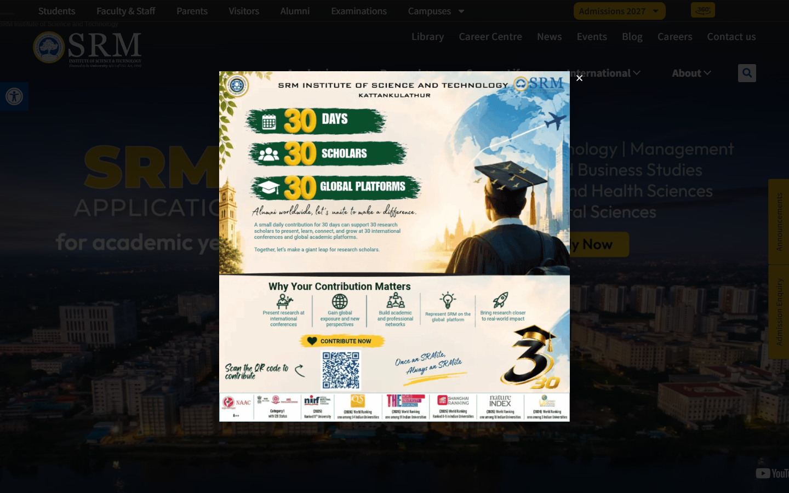 | 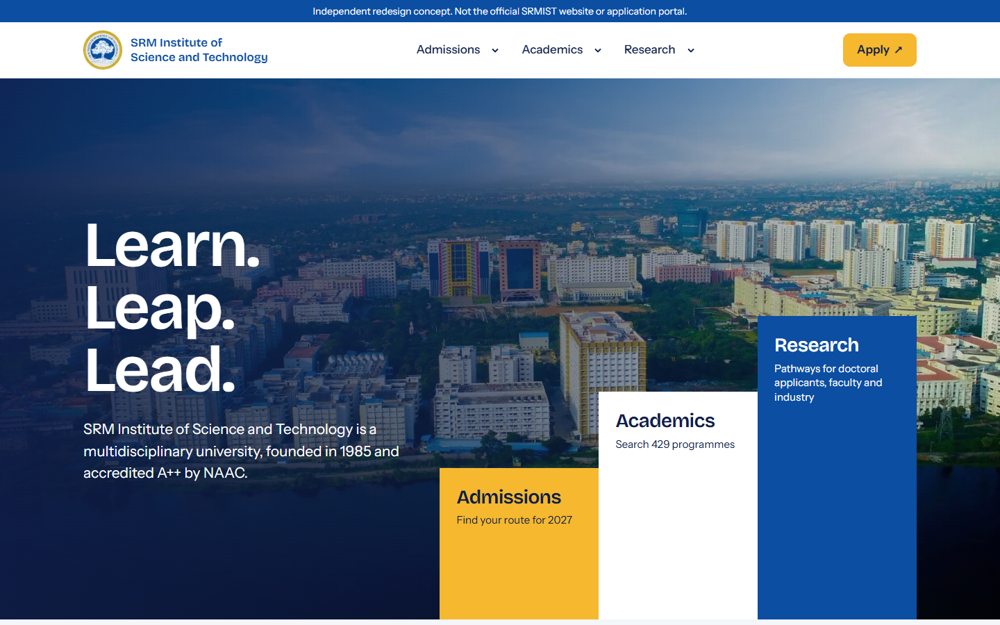 |
| Mobile 390x844 | 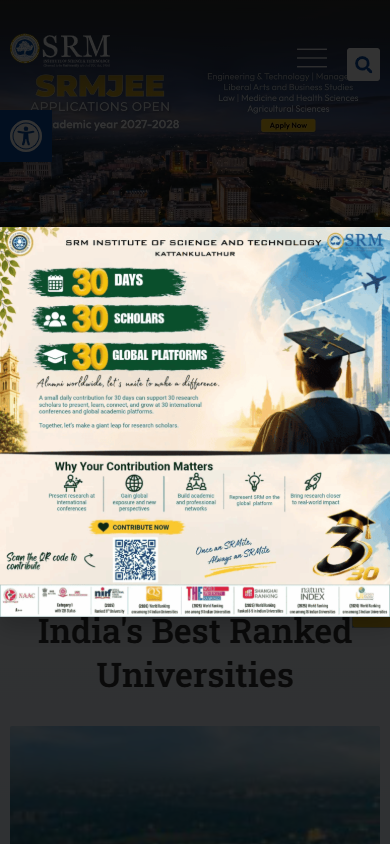 | 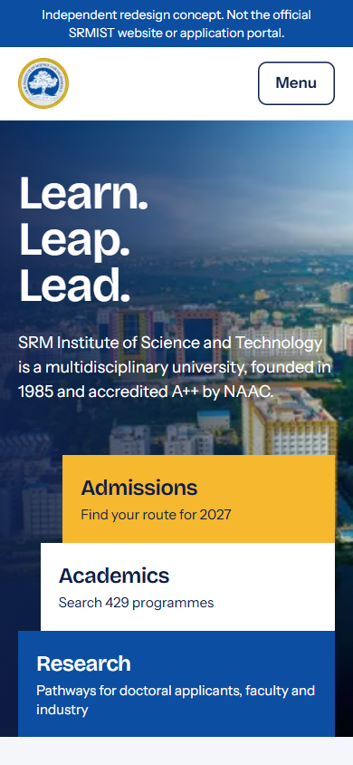 |

Menu comparison:

| As-Is | To-Be (concept) |
| --- | --- |
| 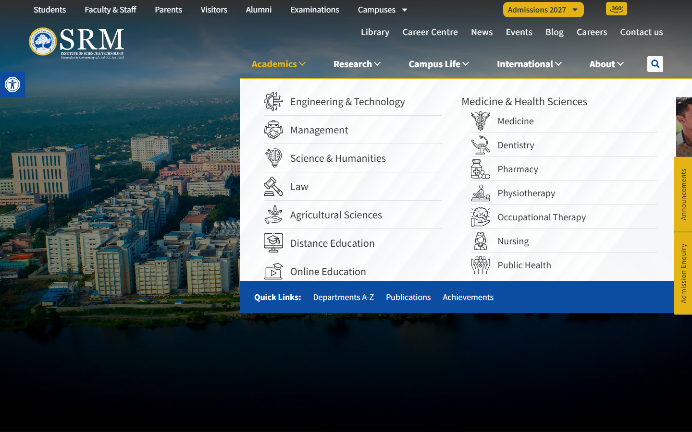 | 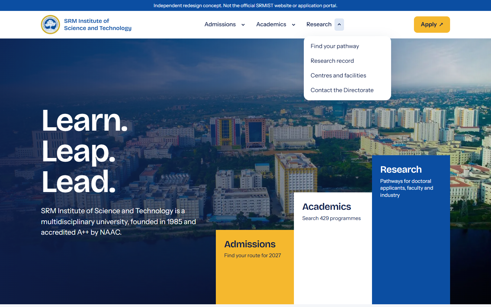 |

### Admissions

Issue: the hub promotes before it guides. Impact: applicants struggle to find their route. Fix: the first screen offers the two official portals, followed by steps and routes.

| Viewport | As-Is | To-Be (concept) |
| --- | --- | --- |
| Desktop 1440x900 | 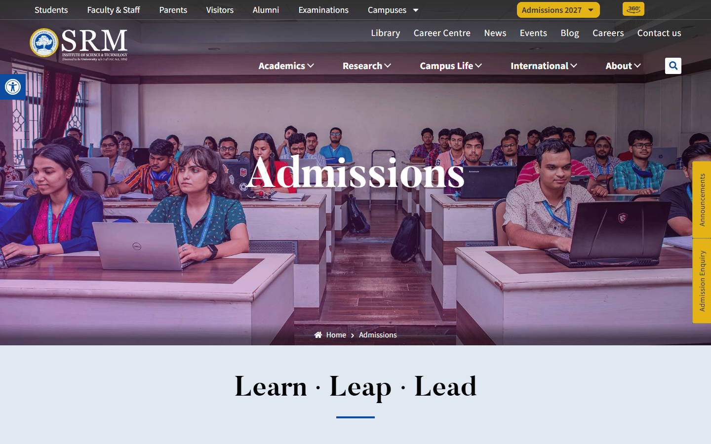 | 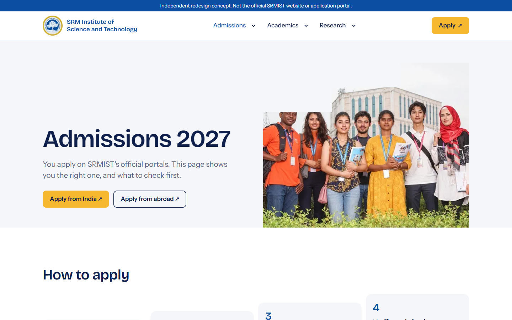 |
| Mobile 390x844 | 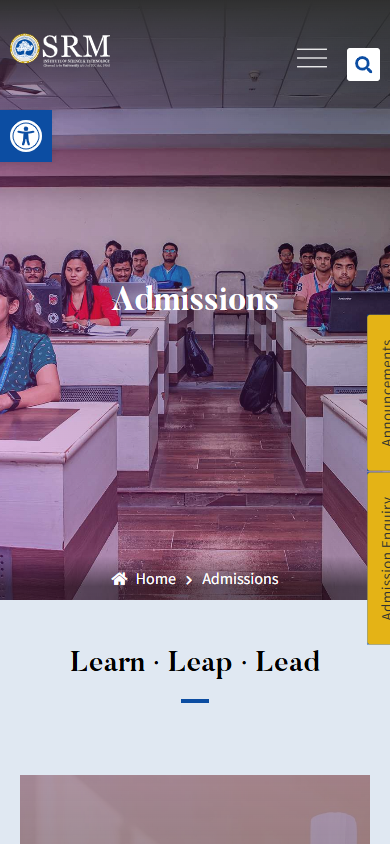 | 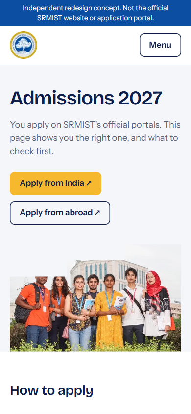 |

### Academics

Issue: no result count, unlabelled filters, 72 pages. Impact: slow and inaccessible discovery. Fix: one labelled search with a live count.

| Viewport | As-Is | To-Be (concept) |
| --- | --- | --- |
| Desktop 1440x900 | 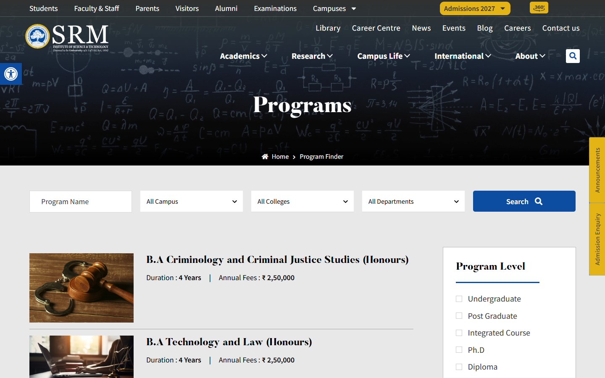 | 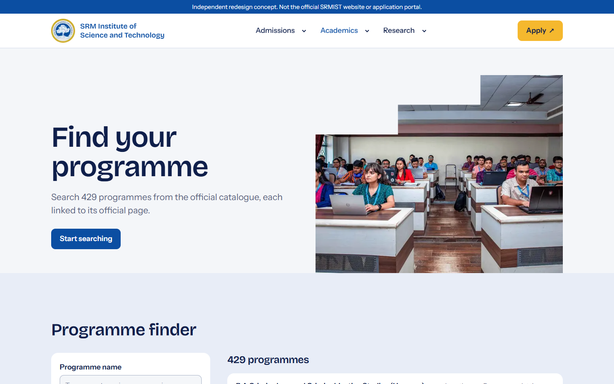 |
| Mobile 390x844 | 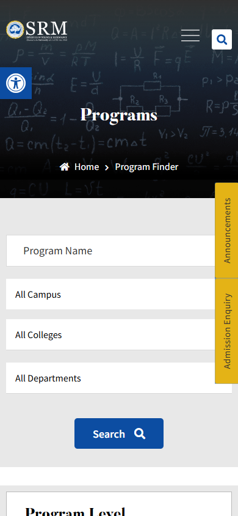 | 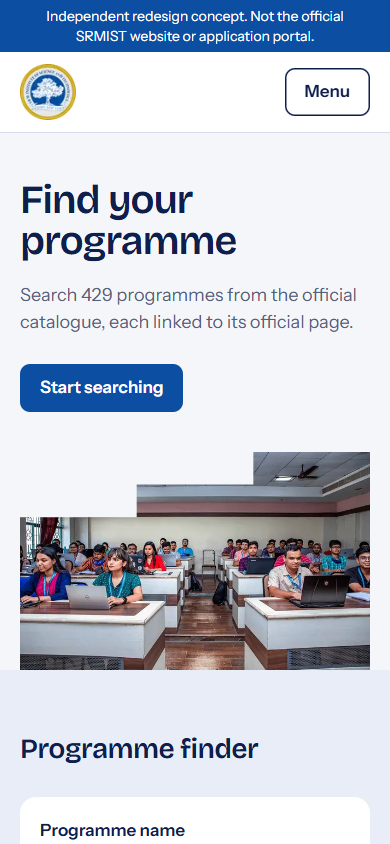 |

### Research

Issue: one long page, not organised by need. Impact: each audience must search. Fix: pathways by audience, with figures that state their limits.

| Viewport | As-Is | To-Be (concept) |
| --- | --- | --- |
| Desktop 1440x900 | 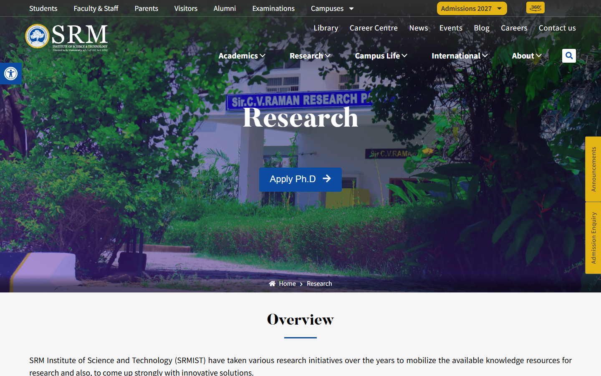 | 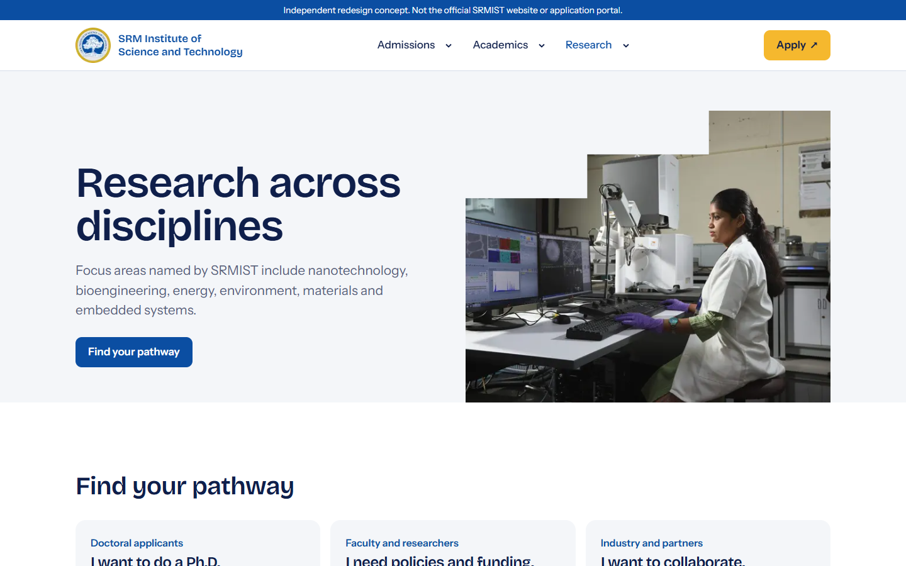 |
| Mobile 390x844 | 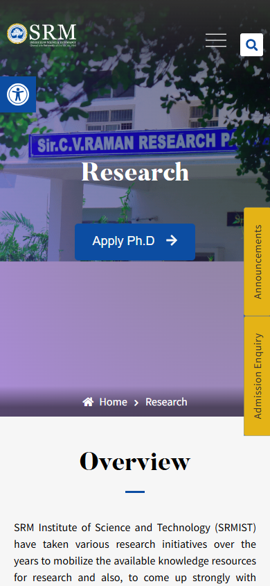 | 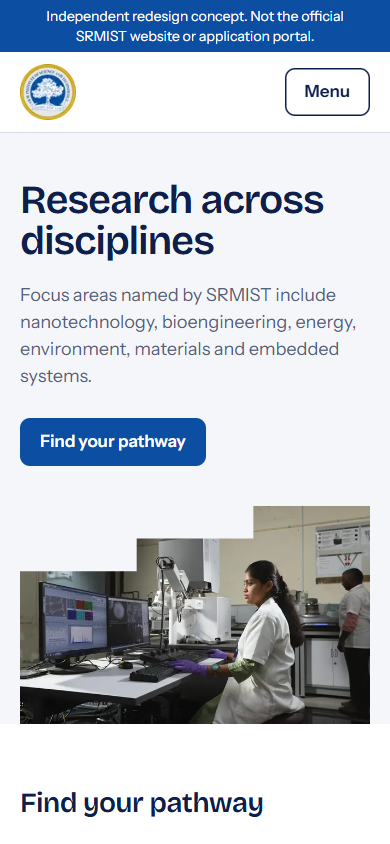 |

## 7. Technical and accessibility checks

### axe-core violations by rule (nodes affected)

| Page | As-Is | To-Be |
| --- | --- | --- |
| Homepage | 6 rules: link-name 36, color-contrast 17, nested-interactive 5, button-name 2, aria-required-children 1, aria-allowed-attr 1 | 0 at all three viewports |
| Admissions | 6 rules: link-name 7, color-contrast 7, nested-interactive 5, aria-required-children 2, button-name 1, aria-allowed-attr 1 | 0 at all three viewports |
| Program Finder / Academics | 7 rules: link-name 13, nested-interactive 5, color-contrast 4, select-name 3, aria-required-children 1, button-name 1, aria-allowed-attr 1 | 0 at all three viewports |
| Research | 6 rules: link-name 17, nested-interactive 5, color-contrast 4, aria-required-children 3, button-name 1, aria-allowed-attr 1 | 0 at all three viewports |

As-Is was tested at 1440x900 with the overlay closed. axe finds only part of all accessibility issues, so zero violations is not proof of full conformance. No screen reader testing was done.

### To-Be functional checks (Playwright, production build)

| Check | Result |
| --- | --- |
| `next build` | Success. All routes prerendered as static. |
| Horizontal overflow at 1440, 768, 390 | 0px on all 4 pages |
| `h1` count | 1 on each page |
| Console errors, broken images | None |
| Finder: all, "computer", plus Ph.D, no match, clear | 429, 39, 2, 0, 429 |
| Duration filter | Works ("1 year" returns 12) |
| Menu button by keyboard | Enter opens, Tab enters the menu, Esc closes |
| Campaign notice | Dismisses and stays dismissed after reload |
| Homepage links | `/admissions`, `/academics`, `/research` |

## 8. Official content and image sources

Content was read from the pages in section 2 on 5 November 2026. Each fact in `data/site.ts` is tied to one of them.

| Content | Source |
| --- | --- |
| 429 programmes (name, level, duration, fee, intake, link) | https://www.srmist.edu.in/program-finder/ |
| NAAC, NIRF 2025 and QS figures, accreditation bodies | https://www.srmist.edu.in/about-us/accreditations-and-rankings/ |
| Application routes | https://www.srmist.edu.in/admission-india/ |
| International waivers | https://www.srmist.edu.in/admission-international/ |
| Scholarship categories | https://www.srmist.edu.in/admission-india/engineering/scholarships/ |
| Research figures, centres, contact | https://www.srmist.edu.in/research/ |
| Campaign text and link | Homepage overlay, https://alumni.srmist.edu.in/funds/view/2988.dz |

| Image | Official source |
| --- | --- |
| `public/images/campus.jpg` | https://www.srmist.edu.in/wp-content/uploads/2025/12/SRM-Institute-of-Science-Technology-Learn.-Leap.-Lead.webp |
| `public/images/lab.jpg` | https://www.srmist.edu.in/wp-content/uploads/2022/03/Chemistry-research-149-1-1536x1024.jpg |
| `public/images/cohort.jpg` | https://www.srmist.edu.in/wp-content/uploads/2024/12/Admission-India-SRMIST-1-Copy.jpg |
| `public/images/building.jpg` | https://www.srmist.edu.in/wp-content/uploads/2022/04/Building_UB_majestic_pic-6-1536x1024.jpg |
| `public/images/classroom.jpg` | https://www.srmist.edu.in/wp-content/uploads/2022/06/classroom-students-.jpg |
| `public/images/techpark.jpg` | https://www.srmist.edu.in/wp-content/uploads/2022/04/tech_park.jpg |
| `public/images/volvo.jpg` | https://www.srmist.edu.in/wp-content/uploads/2026/10/SRMIST-and-Volvo-Group-Partners-to-Set-Up-Vehicle-Technology-Centre.png |
| `public/images/semiconductor.jpg` | https://www.srmist.edu.in/wp-content/uploads/2026/11/srm-semiconductor-summit.jpg |
| `public/images/srm-crest.png` | Official SRMIST crest, supplied by the project team |

These images belong to SRMIST and are used for this concept only. No separate licence was obtained, and they should be cleared before any public use beyond the concept. The people shown in them are identifiable. The crest is SRMIST's trademark, so its use here also needs SRMIST's agreement beyond this concept.

## 9. Unresolved facts and access limitations

| Item | Status |
| --- | --- |
| Application deadlines and exam dates | **Omitted.** No current official date was verified. The site says so. |
| Eligibility by programme | **Omitted.** Not verified at scale. Each programme links to its official page. |
| Campus per programme | **Omitted.** An automated attempt returned all 429 entries for each campus, so the filter had not applied and the result was discarded. The finder uses a duration filter instead. Add campus only after re-collecting it. |
| College, department, mode and type filters | Not carried over. Same reason. |
| Portal deep links | **Not opened.** `applications.srmist.edu.in/btech` and `intlapplications.srmist.edu.in` returned HTTP 429 to our automated checks, with a notice saying the event was logged. Requests to the portal stopped there. This is a result of our testing, not a site defect. The links were copied from the official Admission India page, but they need a manual click-through. |
| Other outbound links | Taken from official pages, not each opened individually. |
| Fees | 385 of 429 entries list a fee. The rest show none. |
| Duration | Values such as `1` were read as years, since most source entries use years. |
| QS figure | Read from the first tab (2027) on the rankings page; that tab being the active one was not separately confirmed. |
| Research figures | No reference period is given by the source. Shown with that caveat. |
| Scholarship list | Taken from the Engineering page; other faculties may differ. |
| "Latest Updates" popup | Found in markup, not opened and viewed. |
| Scope of testing | No real devices, no screen reader, no performance tooling. |
| Deployment | **Not deployed.** See the README for Vercel steps. |
